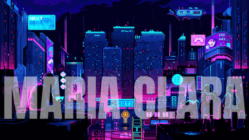

<!-- MasterHead -->

  

 

<!-- Sobre Mim (Alinhado com Tabela Invisível) -->
<table>
  <tr>
    <td width="380" align="center">
      
    </td>
    <td>
      <h3>💫 Sobre Mim</h3>
      

        🌱 Estudante de <strong>Análise e Desenvolvimento de Sistemas</strong> na FATEC Mogi das Cruzes. 
        ⚡ Focada em Desenvolvimento Full Stack, Cloud (AWS), Backend (Go/Java) e Dados.
      

      <h3>🧲 Conecte-se comigo:</h3>
      

        
      

    </td>
  </tr>
</table>

 

<!-- Linguagens e Ferramentas -->
<h3 align="center">💻 Linguagens & Tecnologias</h3>

  
  
  
  
  
  
  
  
  
  
  
  
  
  
  
  
  
  

 

<!-- Projetos -->

  <h3>⭐️ Projetos</h3>
  

    
    
    
  

  

<!-- Ending -->

  

  ✨ Este README foi desenvolvido por <strong>@maclara27</strong>.

